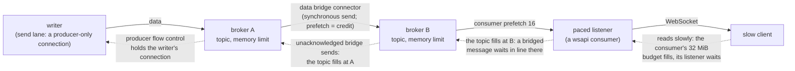

# Data Plane

The data plane is Cresco's **high-throughput streaming** channel. Where the [control plane](messaging.md)
moves addressed MsgEvents over queues, the data plane moves application data over ActiveMQ **topics**
(publish/subscribe), implemented by `DataPlaneServiceImpl` and exposed to plugins as the
`DataPlaneService` library interface.

## Topics

There are three topic scopes, matching the hierarchy:

| Topic type | Default name | Reaches |
|------------|--------------|---------|
| `AGENT` | `agent.event` | subscribers on the same agent |
| `REGION` | `region.event` | subscribers within the region |
| `GLOBAL` | `global.event` | subscribers across the whole federated mesh |

A publisher sends to a scope; every subscriber to that scope with a matching **selector** receives the
message. Cross-region delivery on `global.event` rides the same broker [federation](messaging.md#federation-network-of-brokers)
bridges as the control plane (demand-forwarded).

Under [tenant namespacing](tenancy.md) these topics are qualified per tenant —
`T.<tenant>.{agent,region,global}.event` — so a tenant's streams are isolated at every broker while
same-tenant cross-region flow still works.

## Using it (from a plugin)

```java
DataPlaneService dp = controllerEngine.getDataPlaneService();

// subscribe
String id = dp.addMessageListener(TopicType.GLOBAL, (Message m) -> {
    String body = ((TextMessage) m).getText();
    // ...
}, "myselector = 'value'");

// publish
dp.sendMessage(TopicType.GLOBAL, dp.createTextMessage("payload"));
```

Selectors are JMS message selectors, letting subscribers filter by message properties without the broker
delivering everything.

## Internal use: link-state advertisements

Cresco uses this same pub/sub channel for its own control signalling where a **push** fits better than an
RPC pull. [Cost-aware routing](dynamic-routing.md) rides the `GLOBAL` topic: each controller's
`RouteAdvertiser` publishes its link-state (per-neighbour smoothed RTT, cost, connector count, and dialable
addresses) with the message property `cresco_msg_type = 'route_lsa'`, and every controller subscribes with
that JMS selector to assemble a mesh-wide `RouteView`.

These advertisements are deliberately cheap: `NON_PERSISTENT`, lowest JMS priority, and a short time-to-live
(a few advertise intervals), so they never queue, never compete with application data, and a dropped one is
simply refreshed on the next tick. This is the canonical example of the design rule — **metrics are pushed as
they change (scales); routing state is never pulled per-decision (does not scale)** — RPC is reserved for
configuration, queries, and one-time reconciliation.

## Streaming to external clients

The [wsapi](../plugins/wsapi.md) plugin bridges the data plane to external [clients](../clients/overview.md)
over WebSockets: a client opens a data-plane stream and receives topic messages as text or binary frames, and what it
sends is published on the `GLOBAL` topic. This powers dashboards and remote consumers. A WebSocket consumer is a
[paced listener](#backpressure-nothing-lost-order-kept): when its client reads slowly its stream waits at the broker
instead of losing frames, and a client that reads nothing for 30 s is closed with status 1013 (see
[wsapi](../plugins/wsapi.md#dataplane-backpressure)).

## Backpressure: nothing lost, order kept

A topic subscriber that falls behind (a wsapi client that reads slower than its stream, an agent behind a slow link, a
bridge) keeps every message. What it has not taken counts against the topic's memory limit at its broker
(`activemq_topic_memory_limit`, 256 MiB per topic per broker); once that is full, producer flow control slows the topic's
writers to what its slowest subscriber takes (`dataplane_backpressure`, default on). Across a bridge the wait travels
back hop by hop:



How order is kept and nothing deadlocks:

- **Writers wait in line.** Under backpressure every dataplane send rides a *send lane*: a producer-only connection
  (`dataplane_send_lanes`, 4; a message's `dp_lane` picks one, lane 0 without one) on which the broker holds the
  connection while the topic is full, instead of parking the message and letting the next one overtake it. Consumers'
  acknowledgements ride the node's other connection, so a held send never holds the acks that would free the topic. An
  in-JVM (`vm://`) lane does the broker's work in the sending thread, so a full topic holds that thread.
- **Bridges wait in line at the receiving broker.** The data connectors of a bridge send synchronously
  (`broker_bridge_sync_send`): the sending broker acknowledges a message only once the far broker has taken it, so the
  bridge's prefetch (`broker_bridge_prefetch_data`, 64) is its credit window. At the receiving broker a bridged topic
  message waits in line while its topic is full. Two brokers whose topics are full of traffic for each other would wait on
  each other forever, so a wait ends once the topic has taken **nothing** for `broker_bridge_flow_control_wait_ms` (10 s):
  the bridge then delivers past the limit (the receiving broker keeps the excess pending, in memory and then its temp
  store) until the topic has room again, and logs it. Nothing is discarded either way; a subscriber that is merely slow
  keeps taking messages, so it never triggers this. Control connectors carry queues, which never fill.
- **Paced listeners.** A listener that implements `io.cresco.library.data.PacedListener` may block in `onMessage` to slow
  its stream. The data plane gives each one a JMS session of its own (every other listener of a node shares one), with a
  consumer prefetch of `dataplane_paced_prefetch` (16) instead of the topic's 100, so a wait holds back only that
  listener's messages, in order. A paced listener must not wait forever: wsapi closes a client that reads nothing.

!!! warning "One stopped reader holds its topic's writers"
    The dataplane topics (`agent.event`, `region.event`, `global.event`, per tenant) are shared by every stream on them,
    so a subscriber that stops reading slows **every** writer of its topic on that broker once the topic's memory is full.
    That is why wsapi closes a WebSocket consumer that reads nothing for `wsapi_dataplane_stall_close_ms` (30 s).

`dataplane_backpressure=false` (or `activemq_topic_producer_flow_control=false`) restores the earlier behaviour: the
broker discards the oldest messages of a subscriber more than prefetch x `prefetch_rate_multiplier` (2.5) messages
behind, counted in `dataplane.broker.discarded` and logged, and a bridged message no longer waits in line at the
receiving broker.

## Stream sequence numbers: loss is never silent

Every message of a stream (one carrying `stream_name`) is numbered by its writer's controller per (writer, `stream_name`,
`type`) in `cresco_seq`. The subscriber's controller checks the numbers, counts what is missing in `dataplane.stream.gap`,
and marks the first message after a gap with `cresco_gap` = how many messages of the stream that subscriber did not get,
leaving the message's body untouched. With backpressure on, a gap means a loss that cannot be avoided: a node or link that
died with messages on the way, a subscriber cut off, or `dataplane_backpressure=false`. A subscriber joining mid-stream,
and a writer that restarts (back to 1), are not gaps. wsapi passes `cresco_seq` and `cresco_gap` to its clients; a
consumer that needs completeness reads them and recovers or reports.

## Sharding (throughput)

For very high throughput a topic type can be **sharded** into `N` shard-topics (`global.event.0..N-1`) via
`dataplane_shards`, so ActiveMQ's per-destination demand-forwarding spreads cross-node traffic across
parallel bridge connectors. With `dataplane_parallel_connections`, each shard rides its own dedicated
broker connection (parallel sockets) rather than multiplexing over one pooled session. Defaults keep the
original single-topic behavior. See the [Configuration reference](../reference/configuration.md).

## File transfer

Large payloads (files) are chunked and streamed as a sequence of `BytesMessage` parts through the broker,
reassembled and checked by the receiver against each part's and the whole file's SHA-256 content hash. This is the [BULK](messaging.md#quality-of-service) QoS
tier — persistent but lowest priority, so it never delays the control plane.

## Complex event processing

`DataPlaneServiceImpl` embeds a lightweight CEP engine (`CEPEngine`) that can run windowed/aggregating
queries over a stream (e.g. time-batched averages), producing derived streams — useful for in-fabric
telemetry roll-ups without an external stream processor.
