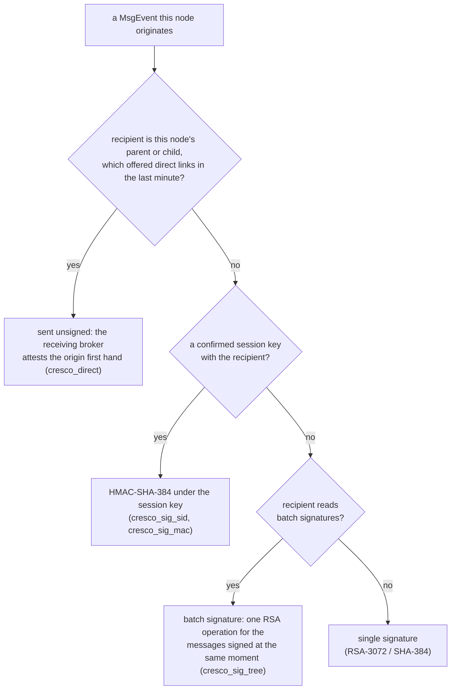
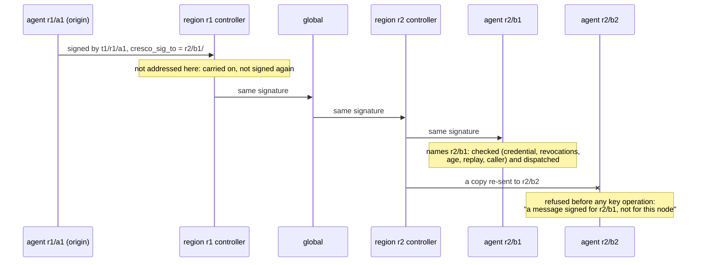

# Message authentication

A broker vouches for one hop. Across several brokers (relays, source routes, the bridges of other regions) the receiver
also needs the **origin's** word, so every MsgEvent a node originates is authenticated end to end, and the receiver checks
it before it dispatches the message locally or completes an RPC with it. This runs whenever security is on (the default)
and `msg_signing_required` is true (the default; it cannot be turned off in production). Source:
`controller/docs/caller-authorization.md` section 10 and `MsgSigning`, `MsgSessions`, `MsgBatchSigner`, `ReplayMemory` in
the controller.

## Three ways a message is authenticated

As a message leaves the node that originated it, the node picks the first that applies:

A relay never signs what it carries, and an in-JVM delivery is never signed.

## What is covered: the recipient too

A signature or MAC covers the message's type, its source header and every parameter except what infrastructure rewrites
in transit (`routepath-*`, `linkcost-*`, `srcroute*`, `ttl`, the broker's caller stamp `cresco_caller*`) and the
signature itself. The origin's caller is covered as a copy (`cresco_sig_caller`, `cresco_sig_caller_tenant`,
`cresco_sig_caller_roles`), next to the signer (`cresco_sig_by`, `<tenant>/<region>/<agent>`), its credential
(`cresco_sig_cred`) and the signing time (`cresco_sig_ts`).

The destination header is not covered (the controller tiers, source routes and `region_alias` rewrite it), but the
**recipient** is, in `cresco_sig_to`:

- `<region>/<agent>/<plugin>`: the node and plugin the message is for, as the origin's router decided it (after the
  controller tiers; the last waypoint of a source route). The plugin is empty for the node itself.
- `^<region>/<agent>`: a function of the global that an agent hands its region controller to carry on. Only a global whose
  child region controller that is accepts it, and only from a signer of that region.

A receiver refuses a signed or MAC'd message that does not name it (or its former address, `region_alias`), before any
key operation. A message signed for one node is never accepted by another, whoever re-sends it.

What a node only carries on (a source route's waypoint, a region controller carrying an agent's global function, a
message not addressed to it) is not checked on arrival but marked, and checked wherever it is then dispatched on that
node, whatever re-addressed it on the way. Nothing is dispatched unverified.

## Who signs, and what a receiver trusts

- **Keys.** Node keys are RSA-3072, signed with SHA-384.
- **Credentials.** A region or global controller presents its leaf certificate. An agent presents an *attestation* from
  its region controller (tenant, region, name, public key, and the certificates its key stands on, by reference), valid
  `msg_signing_attestation_hours` (24) and renewed on its pings when a third of its life is left; until it holds one, its
  certificate. An agent uses an attestation only while it is its own: for its present name and key, and from its present
  region controller. A controller that comes back with another key attests its agents anew on their next ping (each ping
  names the key that signed the attestation the agent holds), and an agent that joined another controller signs with
  its certificate until that controller attests it.
- **The trust bundle.** The global lists the region and global controller keys it verified (each region presents its
  certificate on its pings), signs the list and sends it down on its pongs; each region re-signs what it verified for its
  agents. The bundle carries a version number bumped on each change, so a child's ping costs its parent the same at any
  fabric size, and it is signed and compressed once per change. A controller the global no longer lists is still trusted
  for `msg_signing_bundle_grace_ms` (15 min).
- **Credentials are verified once and cached** (a bounded LRU), but **revocations are checked on every message**, for the
  signer and, for an attestation, its issuer: a key revoked on this node (any scope), a tombstoned name, a certificate out
  of its validity and, with an operator PKI, the operator's `revocation_file` (a listed key or certificate, a CRL serial, a
  CRL past its `nextUpdate`: fail closed). A revocation that comes into force (a reload of `revocation_file`, a revoked
  key, a merged list) also re-verifies every cached credential, drops the sessions of what it now refuses and, at a
  global, drops refused region controllers from the trust bundle it sends down.
- **The caller.** The signer must be the node of the signed caller (its controller or one of its plugins), or, for an API
  user, a node of the user's tenant (any tenant's from a superuser tenant). The broker's stamp, when there is one, must be
  that caller.

## Direct links: no relay, no signature

Between a node and its own parent or child (an agent and its region or global controller, a region and its global) there
is no relay: the broker the receiver consumes from took the message from that very node, over the node's verified
connection or the verified bridge of that very controller. That broker says so in `cresco_direct`
(`<tenant>/<region>/<agent>`), which only a broker writes (whatever a sender put there is replaced at every broker), and
only when the sender declared itself the origin and its stamp was accepted for that connection. Such a message travels
unsigned (`msg_signing_direct`, default true).

The receiver alone decides: it accepts an unsigned message only when the broker it consumes from attests it first hand
from the node whose word the stamp is. A controller trusts its own broker's attestation; an agent trusts its parent's
broker only for the parent's own messages. Each side offers direct links on its pings and pongs (`sig_direct_ok`), and a
node sends unsigned only to a parent or child that offered them within the last minute, so a node of an earlier hardened
build is always sent signatures. The bulk of the control plane (keepalives, registrations, pings, the replies of regions
and the global) is direct and costs no cryptography beyond TLS.

A direct link ends with the link, not a minute later. A parent stops sending a child unsigned messages the moment the
last consumer of that child's inbox leaves its broker (the child stopped, moved to another controller, or its connection
broke), and a ping the child sent before that does not re-open the link. A child signs what it sends its parent while its
link is down and for the first message after each join; that first ping carries no offer, which withdraws the link at
the parent too, so the first pong of a join is signed whatever path it takes, and the next ping and pong offer the link
again. After a ping that went unanswered both sides sign for a minute before the direct link is tried again: the ping
or its pong may have been lost because it travelled unsigned by another controller's bridge, where it is not first hand. (Builds before
2026-11-11 kept the offer for the full minute: a node that had moved to another region and still answered at its former
address refused its former parent's messages as `an unsigned message (..., not delivered first hand)` for up to 60 s, and
a restarted global refused the first ping of each region.)

## Batch signatures

Messages a node signs at the same moment share one private-key operation: each message is a leaf
(`SHA-384(0x00 || canonical form)`) of a Merkle tree (`SHA-384(0x01 || left || right)`), the node signs
`"cresco-msg-batch-v1" || 0 || count || root`, and each message carries the signature and its own path to the root
(`cresco_sig_tree`, `<index>/<count>:<sibling>,...`). Each message still verifies on its own: the receiver recomputes the
root from the message, checks the root's signature once per batch (then cached) and records the signature and leaf in its
replay memory. A message alone in its batch (whenever the node is not busy) gets an ordinary signature, so no latency is
added; under load up to 256 share one, signed by `msg_signing_threads` workers. A node sends batch signatures only to a
node it verified a message from that said it reads them (`cresco_sig_caps` contains `batch`; covered by the signature).

## Session keys

Two nodes that talk across relays agree once on a key only they hold, then authenticate each message with an
HMAC-SHA-384 under it instead of a signature, and the signer's credential no longer travels with every message.

- **Agreement.** The first node to send to a peer that reads session keys (`cresco_sig_caps` contains `session`)
  attaches an ephemeral P-384 public key to a signed message (`cresco_sig_kx`); the peer answers with its own on its next
  message (`cresco_sig_kxa`). Each side derives the key from the ECDH secret (SP 800-56A ephemeral-ephemeral; SP 800-56C
  two-step key derivation with HMAC-SHA-384 over both names and both public keys). A relay never sees the key, so it
  still cannot forge, alter, replay or re-address what it carries (the MAC covers the recipient like a signature).
- **Offer and answer rules.** A message carrying an offer or an answer is always signed, never MAC'd, and a receiver acts
  on an offer or answer only from a signed message, so an agreement costs its sender a signature and every renewal
  refreshes both credentials. While a session is usable, an offer or answer rides at most one message a second. An offer
  is accepted from a peer at most once every 10 s, under that peer's own lock: no peer can make a node spend more, or hold
  up the others.
- **Renewal never interrupts.** An offer from a peer that still holds the confirmed session goes to a pending slot; both
  keep sending under the confirmed session until the peer uses (or names) the new one. Sessions last
  `msg_signing_session_seconds` (one hour) and are renewed ahead of their end.
- **Restarts.** Every message to a peer names the session the sender holds with it (`cresco_sig_held`) and the sender's
  incarnation (`cresco_sig_inc`, random at each start). A node sends under a session only while its peer said within the
  last 30 s that it holds it; a message from the peer that names another session, or a new incarnation, makes it return
  to signatures and agree anew. A message sent to a restarted node under the session it lost is refused like any
  unauthenticated message (an RPC is answered `401`).
- **Checks.** The receiver checks the signing time, the replay memory, the signed caller, the broker's stamp, and the
  signer's credential and revocations on every MAC'd message exactly as for a signature; a revoked key's session is
  dropped. A MAC convinces its one receiver only, which is all a MsgEvent needs.
- A node of an earlier build, or one with `msg_signing_sessions=false`, never reads session keys and is always sent
  signatures. A crypto provider that refuses any of it (a FIPS module raising an error) turns session keys off on that
  node, logged once: it stays with signatures.

## What the receiver refuses

An unsigned message (unless delivered first hand on a direct link, or from an earlier-build agent inside the
[upgrade window](upgrade.md)), a bad signature, MAC or credential, a message that does not name it, a signature older
than `msg_signature_max_age_ms` (5 min) or signed more than `msg_signature_max_future_ms` (60 s) ahead of this node's
clock, and one seen before (a replay). Each
refusal is counted under its reason (`msg.refused.<reason>` in the metric inventory) and logged as
`MESSAGE SIGNATURE: REFUSED <why>`: each reason at its first occurrence, then at most every 10 s, with the node's total
and that reason's count; an RPC request is answered `401 unauthenticated`. The reasons are listed in [Troubleshooting](../operations/troubleshooting.md#message-signature-refused).

## Bounded state

Every table is bounded and O(1) per message, so nothing grows with the size of the fleet:

- **Replay memory**: every signature and MAC accepted, kept in the bucket of its signed time for one max-age (the first
  64 bits of its SHA-256, in primitive tables). Each signer has its own memory, whose check-and-record is one step under
  one lock: at most an eighth of `msg_replay_memory_max` entries each, and `msg_replay_memory_max` in all. A signer past
  its bound has its own oldest bucket dropped, and from then on what IT signed in or before that bucket is refused as
  too old; no other signer is affected, and a replay is never accepted. A bucket goes once its signing times are past
  the max age, and a signer's memory once it is empty and idle, so the memory holds about one max-age of traffic: at
  the default bound, some 10,000 signed or MAC'd messages a second in all. When all signers together reach the bound,
  the oldest signing times are given up in every signer's memory at once: a message signed before them is then refused
  as too old (the age a message may have shrinks), and fresh messages are accepted. Only a flood that fills the bound
  within one bucket's time (an eighth of the max age) is refused outright. (One shared memory let a single node fill it
  with messages signed ahead of the clock and so have every other signer refused for minutes.)
- **Credentials**: an LRU of `msg_signing_credentials_max` verified credentials; past it the least recently used goes.
- **Held messages**: a signed message a node cannot judge YET -- in its first moments with a parent, before that parent's
  pongs brought its trust data (15 s at most), or later when the signer's controller is not in the trust bundle it
  holds -- is held, not refused: at most `msg_signing_hold_ms` (5 s), 2048 messages and 32 MiB of text, and an eighth
  of the messages from one sender (what is held is not verified yet, so one sender cannot take the room of the others).
  It is verified again when the trust data changes and once more when its time is over; then it is accepted or refused
  as it stands. A message that does not fit is refused at once. The wait for a parent's trust data belongs to every
  join -- a region that joins or rejoins its global, an agent that moved -- not to a node's first seconds alone.
- **Trust data arrives at once, and on demand**: a node pings its parent the moment it joins (not one ping interval
  later), so the trust bundle, an agent's attestation and the parent's revocations are in within one round trip. A node
  counts as ready only when it holds the parent's WHOLE revocation list: a list longer than one pong carries
  (`revocation_sync_max_entries`, 4096) is whole with its last part, and until then the node holds what it cannot judge
  (a parent of an earlier build does not say how long its list is; a node below it judges with what it has, as before).
  A node that holds a message asks for what it lacks: it pings its parent again at once, at most once a second and for
  5 s after the last such message, and a region asked so by one of its agents asks the global in turn. Nothing waits for
  the next regular ping.
- **Sessions**: one entry per peer node, at most `msg_signing_sessions_max`; a full table gives a new peer no session (its
  messages stay signed) and never evicts one in use.

## Cost

Between two nodes that talk both ways: one ECDH agreement per pair and hour, then an HMAC per message (about 15 us to
check). Otherwise one signature per message a node originates to anything but its parent or children (an RSA-3072
private-key operation, about 2 ms of one core, shared by a batch under load) and one signature check per message
dispatched (about 0.08 ms); a signed message carries its signer's credential (about 2.2 KB). Direct-link messages cost no
cryptography beyond TLS.

Measured with `controller/docs/tests/control_plane_bench.sh` on one host (2026-11-09): RPCs from a client at the global to
an agent of another region, across its region's bridge, 8 concurrent callers.

| Build / mode | p50 | Rate |
|---|---|---|
| before the 1.3 hardening | 1.1 ms | 3948/s |
| per-message signatures | 5.9 ms | 1371/s |
| with session keys | 1.4 ms | 3410/s |
| production (FIPS), per-message signatures | 7.1 ms | 1094/s |
| production (FIPS), with session keys | 1.8 ms | 3228/s |

The multi-host release gate, the release against the previous build in both profiles, is on
[Performance](../operations/performance.md).

## Settings

| Setting | Default | Meaning |
|---|---|---|
| `msg_signing_required` | `true` (with security on; required in production) | authenticate every message a node originates and check it before dispatch |
| `msg_signature_max_age_ms` | `300000` | how old a signature may be (at least 10 s) |
| `msg_signature_max_future_ms` | `60000` | how far ahead of the receiver's clock a signing time may be: the allowance for clock differences between nodes (1 s to the max age) |
| `msg_signing_attestation_hours` | `24` | an agent attestation's lifetime |
| `msg_signing_bundle_grace_ms` | `900000` | how long a controller dropped from the global's trust bundle is still trusted |
| `msg_signing_direct` | `true` | messages between a node and its parent or children travel unsigned, attested first hand by the receiving broker |
| `msg_signing_batch` | `true` | messages signed at the same moment share one signature (a Merkle root), to nodes that read them |
| `msg_signing_threads` | half the cores, 2 to 8 | signing workers; each signs a batch at a time |
| `msg_signing_sessions` | `true` | end-to-end session keys with the nodes that read them |
| `msg_signing_session_seconds` | `3600` | a session key's lifetime, renewed ahead of its end (at least 120) |
| `msg_signing_sessions_max` | `200000` | peers a node holds sessions with; past it, a new peer stays signed |
| `msg_signing_credentials_max` | `100000` | credentials held verified (an LRU) |
| `msg_signing_hold_ms` | `5000` | how long an inbox holds a signed message it cannot judge yet before it is accepted or refused as it stands (at most 60 s; `0`: refused at once) |
| `msg_replay_memory_max` | `4000000` | signatures and MACs the replay memory holds in all (at least 4096), an eighth of it at most for one signer; a signer past its bound has its own oldest signing times refused as too old, and so have all signers when together they reach the whole bound. Size it at the node's signed and MAC'd messages per max-age (5 min): the default serves about 10,000 a second |

## Checking a node

At the first message of each kind a node logs, once: `message signatures ON: this node signs what it originates` and
`... checks what it dispatches`, `direct links ON: ...` (on each side of a direct link) and `session keys ON: ...`.
`MESSAGE SIGNATURE: REFUSED ...` names every refused message.
